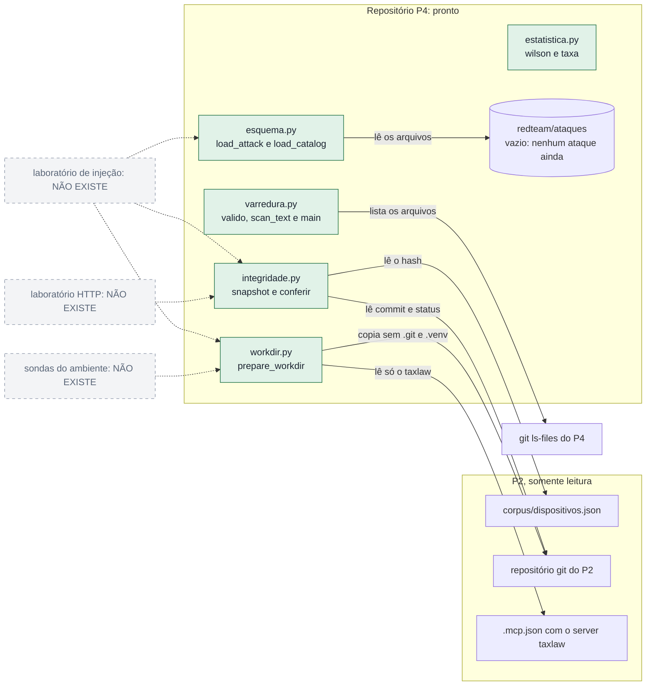
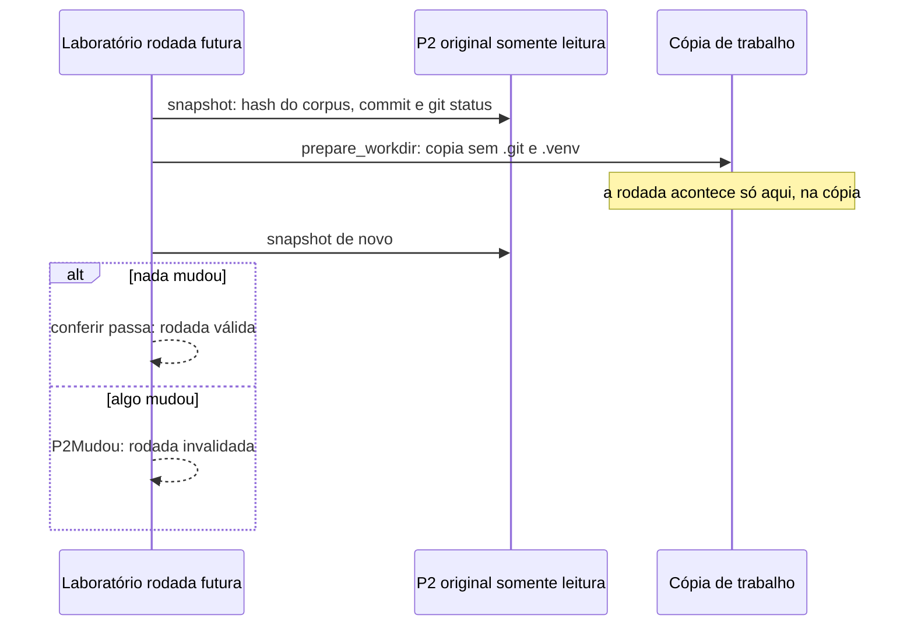
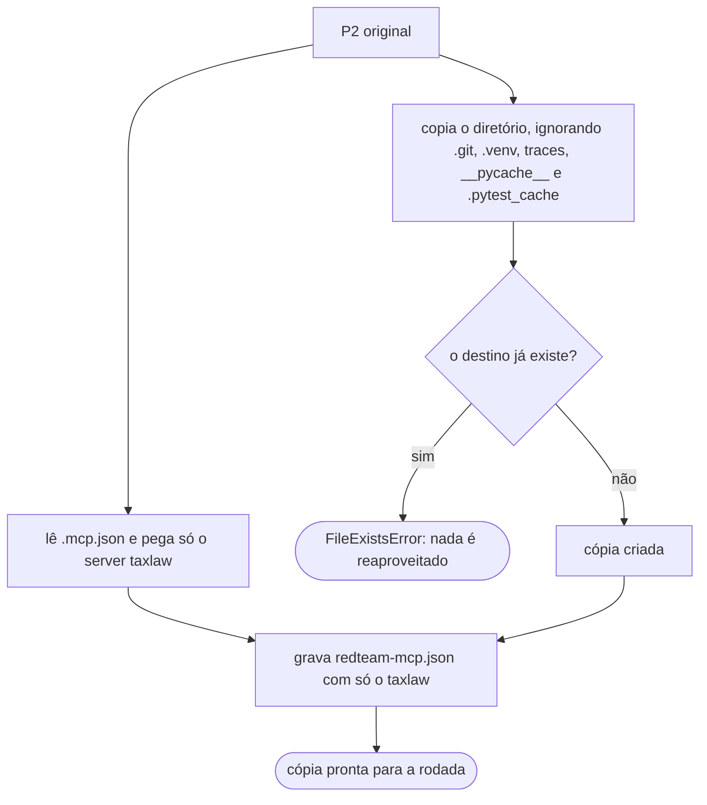
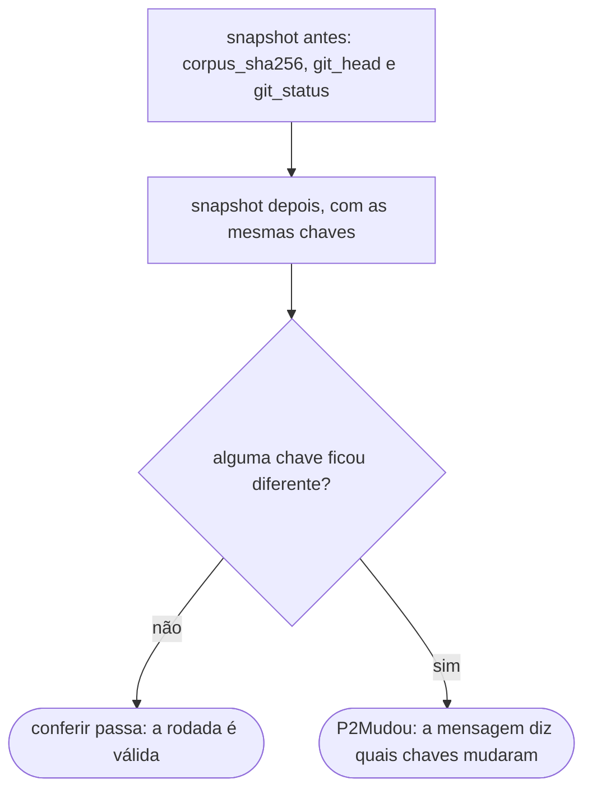
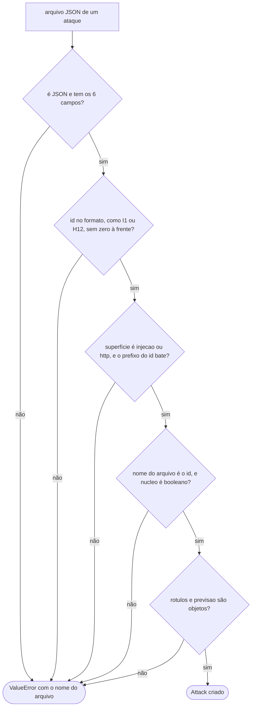
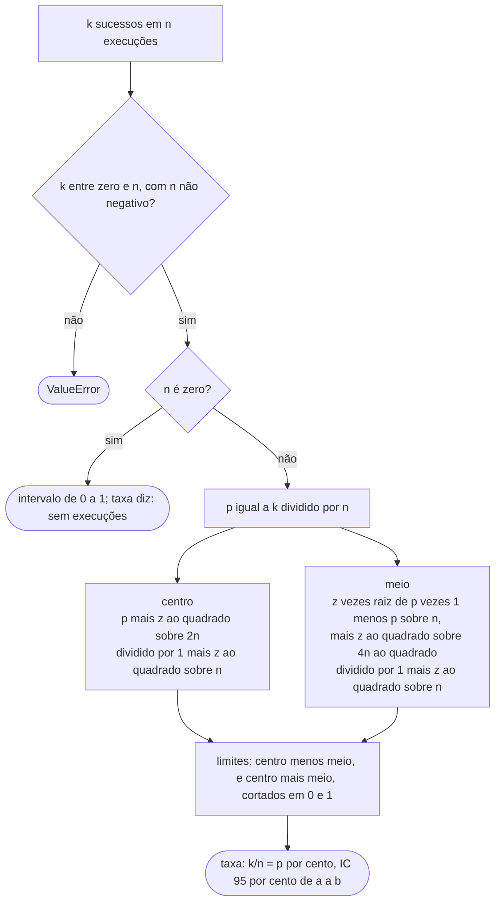
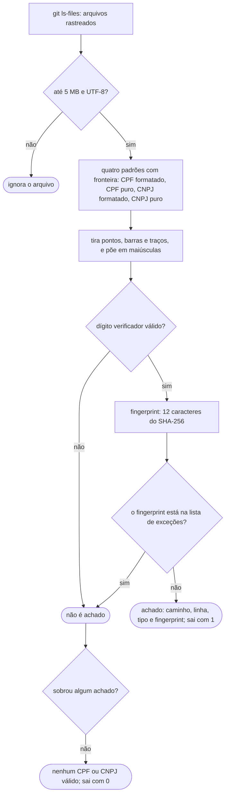

# Red team no P2: diagramas do que já está implementado

Esta página mostra **só o que existe no código**, em 31 testes verdes. O que ainda não existe aparece tracejado e marcado como "não existe". Os laboratórios de injeção e HTTP, o catálogo de ataques e as sondas estão fora do escopo desta fase.

**Legenda:** verde = pronto e testado · tracejado = ainda não existe · losango = decisão · pílula = fim (sucesso ou erro).

---

## 1. Mapa do pacote

**Como ler.** Cada caixa verde é um módulo com testes. As setas sólidas são leituras reais do código. As tracejadas são ligações que só existirão quando os laboratórios forem escritos. `estatistica.py` não tem seta porque ainda não tem consumidor: o relatório que a usará não existe.

**O que prova.** Os cinco módulos funcionam sozinhos, cada um com seus testes.

**O que não prova.** Que um ataque real seja executado. Nada aqui chama o modelo nem a rede.

---

## 2. Ciclo de uma rodada (como a integridade protege o P2)

**Como ler.** O P2 original é consultado duas vezes, antes e depois. Entre as duas consultas, nada roda nele: a rodada acontece só na cópia.

**O que prova.** Se o P2 for alterado durante a rodada, a conferência detecta, com o nome da chave que mudou.

**O que não prova.** A rodada em si. O laboratório que a executaria ainda não existe; o diagrama mostra só o contrato de integridade.

---

## 3. Cópia de trabalho do P2 (`prepare_workdir`)

**Como ler.** A configuração MCP da cópia leva só o server do P2 que o laboratório usará. Os outros servers do `.mcp.json` não entram, e a cópia não herda `.venv` nem `.git`.

**O que prova.** Um destino já usado nunca é reaproveitado por engano. A cópia não tem `.venv`, e a configuração só tem o `taxlaw` (dois testes).

**O que não prova.** Que a cópia rode. Ela só é preparada.

---

## 4. Conferência de integridade (`conferir`)

**Como ler.** A comparação é chave por chave. Não há "parecido": um byte a mais no corpus já muda o hash.

**O que prova.** Três casos, testados: snapshots iguais passam; mudança no corpus e arquivo novo sem rastreio são detectados (três testes).

**O que não prova.** Que o P2 esteja "limpo". A linha de base já tinha duas alterações (`meister.config.yaml` e um `.bak`). A regra é "não mudou", e não "está perfeito".

---

## 5. Validação de um ataque no catálogo (`load_attack`)

**Como ler.** Cada losango é uma regra, na ordem em que o código a verifica. A primeira regra quebrada para tudo, com uma mensagem que cita o arquivo.

**O que prova.** Dez casos de erro e um de sucesso testados, mais a ordem do catálogo: injeção antes de HTTP, e por número dentro de cada uma (dez testes).

**O que não prova.** O conteúdo do ataque. O esquema valida só os campos comuns; o bloco de entrada e de critério será validado pelo laboratório que o usar. O diretório `redteam/ataques` está vazio.

---

## 6. Taxa com intervalo de Wilson (`wilson` e `taxa`)

**Como ler.** O centro e a metade do intervalo são calculados separadamente, e depois se cortam os limites em 0 e 1. O caminho de `n = 0` é um atalho, para não haver divisão por zero.

**O que prova.** Os valores de 0 de 5, 2 de 5 e 5 de 5 batem com os esperados, e os casos inválidos e n = 0 são recusados ou tratados (oito testes).

| Caso | Taxa exibida |
|---|---|
| 0 de 5 | 0% (IC 95%: 0% a 43%) |
| 2 de 5 | 40% (IC 95%: 12% a 77%) |
| 5 de 5 | 100% (IC 95%: 57% a 100%) |

**O que não prova.** Que o relatório use essas taxas: ele ainda não existe.

---

## 7. Varredura de números de contribuinte (`main`)

**Como ler.** O número nunca aparece na saída, só o fingerprint. A regra de dígito verificador é o que separa um CPF real de um número de processo com a mesma forma.

**O que prova.** Números válidos são achados, em formato puro e formatado; DV errado e número colado não são; arquivos binários são ignorados; a lista de exceções funciona; e o `main` sai com 1 ou 0 (sete testes). Na execução sobre o P4, nenhum achado.

**O que não prova.**
- Roda **à mão**. Não há gancho de commit nem CI, e a spec pede varredura automática.
- CNPJ alfanumérico em minúsculas não é coberto.
- Um número de 11 dígitos com DV válido por acaso vira achado; a solução é a lista de exceções pelo fingerprint.

---

## Resumo do que existe

| Módulo | Testes | Pronto para | Ainda falta |
|---|---|---|---|
| `integridade.py` | 3 | conferir o P2 antes e depois | a rodada que a usaria |
| `workdir.py` | 2 | preparar a cópia do P2 | o laboratório que roda dentro dela |
| `esquema.py` | 10 | validar a parte comum de um ataque | o conteúdo dos ataques |
| `estatistica.py` | 8 | calcular taxas com intervalo | o relatório que as usaria |
| `varredura.py` | 7 | achar CPF e CNPJ válidos nos arquivos | rodar automaticamente no commit |
| **Total** | **31** | | |

Plano: [`docs/superpowers/plans/2026-11-18-red-team-p2.md`](../superpowers/plans/2026-11-18-red-team-p2.md) · Spec: [`docs/superpowers/specs/2026-11-18-red-team-p2-design.md`](../superpowers/specs/2026-11-18-red-team-p2-design.md)
